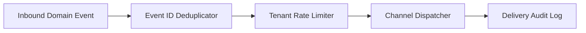

# Event-Driven Notification Pipeline (Java 21)


**Stack:** `Java 21 · Event Deduplication · Rate Limiting · Multi-Tenant Routing`

## Overview
An event-driven notification processing core providing per-tenant sliding rate windows, idempotent event deduplication, and delivery state tracking across notification channels.

## Architecture & Execution Flow


## Key Engineering Capabilities
- **Idempotent Event Deduplication:** Suppresses duplicate upstream events using deterministic event ID tracking.
- **Per-Tenant Rate Windows:** Enforces tenant-specific throughput quotas to prevent noisy-neighbor channel saturation.
- **Explicit Delivery Receipts:** Records accepted, throttled, and duplicate outcomes per event.
- **Automated CI Suite:** Verified on every commit via `java Main.java`.

## Local Verification
Run the self-contained verification suite locally:

```bash
java Main.java
```

## Documentation
- [Architectural Decisions](docs/DECISIONS.md)
- [Security & Isolation Model](docs/SECURITY.md)
