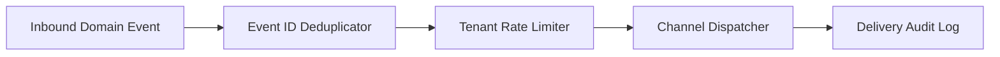

# Event-Driven Notification Pipeline (Java 21)


**Stack:** `Java 21 · Event Deduplication · Rate Limiting · Multi-Tenant Routing`

> [!IMPORTANT]
> **🔒 Enterprise Confidentiality & Clean-Room Reference Notice (For HR & Technical Reviewers)**
> Due to strict **Non-Disclosure Agreements (NDAs)**, SOC2/PCI-DSS security compliance, and proprietary Intellectual Property (IP) governance across enterprise production systems, the full commercial source code, internal infrastructure manifests (Terraform state, Helm charts, internal VPC/IAM topologies), and proprietary third-party adapters cannot be published to public GitHub.
>
> **What is included in this repository:**
> This repository provides a **clean-room, zero-dependency architectural reference core** written from scratch to demonstrate the underlying **domain invariants, state machines, concurrency models, and automated verification suites** without exposing proprietary business logic or client infrastructure. Full architectural walkthroughs and production trade-off discussions are available during technical interviews.

---

## Overview
An event-driven notification processing core providing per-tenant sliding rate windows, idempotent event deduplication, and delivery state tracking across notification channels.

## Architecture & Execution Flow


## Key Engineering Capabilities
- **Idempotent Event Deduplication:** Suppresses duplicate upstream events using deterministic event ID tracking.
- **Per-Tenant Rate Windows:** Enforces tenant-specific throughput quotas to prevent noisy-neighbor channel saturation.
- **Explicit Delivery Receipts:** Records accepted, throttled, and duplicate outcomes per event.
- **Automated CI Suite:** Verified on every commit via `java Main.java`.

## Why a Clean-Room Domain Core?
In enterprise microservices, 80% of production incidents stem from broken domain invariants (race conditions, non-idempotent retries, cross-tenant data leakage, or unbalanced state transitions) rather than HTTP/ORM boilerplate. By isolating the **pure domain engine** from proprietary cloud adapters:
1. **Confidentiality & IP Safety:** Zero proprietary client schemas, credentials, or internal endpoints are exposed.
2. **Deterministic Verification:** Reviewers can clone and execute the full invariant test suite in under 2 seconds (`java Main.java`) with zero external database or cloud setup required.
3. **Clear Architectural Boundaries:** Demonstrates strict separation between domain rules and infrastructure delivery.

## Local Verification
Run the self-contained verification suite locally:

```bash
java Main.java
```

## Documentation
- [Architectural Decisions & Trade-offs](docs/DECISIONS.md)
- [Security, NDA & Isolation Model](docs/SECURITY.md)
